# Tread Control

**Aus einer geschlossenen Laufband-Konsole wird eine offene Trainingsplattform, gebaut zusammen mit einem KI-Entwicklungsagenten.**

Die Horizon Tread-XP hat einen grossen Android-Touchbildschirm, doch was darauf läuft, bestimmt die
Herstellersoftware. Tread Control ersetzt die Trainingsseite durch einen eigenen Steuerdienst und eine
eigene Touch-Oberfläche und macht die Konsole zur offenen Plattform: Jede Android-App (YouTube, Jellyfin,
YouTube Music, Audiobookshelf, Kinomap, Zwift …) läuft im Vollbild, und eine schwebende Steuerpille behält
Band, Trainingsprogramm, Musik und Ventilator im Griff. Dazu kommen Intervall- und Pulstraining,
Trainingspläne und eigene Laufstrecken aus GPX- oder TCX-Dateien mit Luftbildkarte und Höhenprofil live.

Es ist auch ein **Live-Test zum Lernen**: Wie weit kommt eine Person mit einem KI-Entwicklungsagenten
(Claude Code), wenn sie ein echtes Gerät analysiert, sicher, vom ersten nur lesenden Blick bis zum
geprüften Produkt? Angestossen haben die Idee zwei GitHub-Trends aus dem Herbst 2026:
[REA (Reverse Engineer Anything)](https://github.com/morluto/rea), bei dem Agenten Software ohne Quellcode
analysieren, und [CleanYourTV](https://github.com/Gathin23/cleanyourtv), bei dem Claude Code die Kontrolle
über Android-Fernseher zurückholt. Ein Laufband ist dieselbe Idee mit höherem Einsatz: Es kann verletzen,
darum kam die Sicherheit zuerst (siehe [Wie es entstanden ist](#wie-es-entstanden-ist)).

**Version 1.0.0** (28.10.2026), erste öffentliche Fassung · [Releases](https://github.com/andreasgapsch/treadctl/releases)

[English](README.md) · [Sicherheit](SICHERHEIT.md) · [Rechtliches](RECHTLICHES.md) · [Dokumentation](docs/de/) · [Autor: kmu-cio.ch](https://kmu-cio.ch) · [Buy me a coffee](https://ko-fi.com/andreasgapsch)

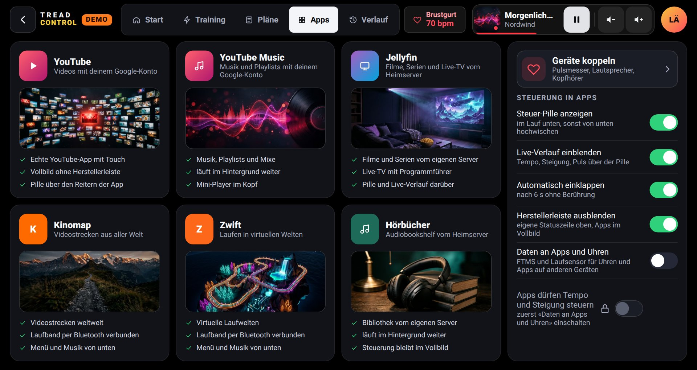

> **Sicherheit zuerst.** Diese Software steuert ein Laufband. Ein Fehler kann zu Stürzen und
> schweren Verletzungen führen. Immer den Sicherheitsschlüssel tragen und vor der Nutzung
> [SICHERHEIT.md](SICHERHEIT.md) lesen. Ohne jede Gewährleistung.

## Funktionen

| | |
|---|---|
| **Apps auf der Konsole** | App-Seite mit YouTube, YouTube Music, Jellyfin, Kinomap, Zwift und Audiobookshelf. Apps laufen im Vollbild ohne Herstellerleiste; nicht benötigte Hilfs-Apps werden aus dem Speicher geräumt, damit Video-Apps schnell starten. Es läuft immer nur eine Trainings- oder Video-App (Zwift, Kinomap, Jellyfin, YouTube); YouTube Music und Hörbücher spielen im Hintergrund weiter. |
| **Schwebende Pille** | Native, deckende Steuerleiste unten in jeder App (YouTube, Jellyfin, Audiobookshelf …): hochwischen zeigt, runterwischen versteckt; Steigung, STOP, Tempo, Live-Verlauf, Wechselbanner, eigene Statuszeile oben, Bildschirmschoner. |
| **Eigene Strecken (GPX/TCX)** | Eigene Läufe nachlaufen: GPX- oder TCX-Dateien vom USB-Stick oder aus «Downloads» importieren (z. B. aus Garmin Connect, Strava oder Komoot exportiert), Name, Art und Kennzahlen vor dem Speichern prüfen, danach unter «Eigene» in der Streckenbibliothek. Höhen werden mit dem Schweizer Geländemodell korrigiert, Zielzeit oder Pace nach Anstrengung verteilt (ACSM-Laufmodell), die Bandsteigung folgt der Strecke 1:1 oder zur Hälfte. Luftbildkarte live in der Schweiz (grün gelaufen, rot offen), Höhenprofil, Soll-Pace, Vorsprung oder Rückstand, Prognose. Nach dem Import vollständig offline. |
| **Intervalle und Pläne** | Pläne aus Blöcken mit Ein- und Auslaufen und Wiederholungen; Wechsel 10 s vorher mit Ton angekündigt. Stufentest zur Bestimmung der maximalen Herzfrequenz mit Sprung ins Auslaufen und Übernahme ins Profil. |
| **Pulszonen** | Tempo folgt dem Puls innerhalb einer Zone, mit Plausibilitätsprüfung und sicheren Rückfällen. |
| **Musik und Hörbücher** | Mini-Player im Kopf für YouTube Music und Audiobookshelf: Wiedergabe, Lautstärke, Wechsel der Quelle und Wahl des Abspielgeräts (Konsole oder Bluetooth-Lautsprecher). |
| **Geräte** | Bluetooth-Pulsgurte und Uhren (z. B. Garmin HRM 600, Forerunner mit HF-Übertragung), Bluetooth-Lautsprecher, Koppeln direkt über den Pulschip im Kopf. Smarter Ventilator CYCPLUS F1 über Bluetooth LE: Stufe automatisch nach Tempo, Steigung und Puls, von Hand über die Pille. |
| **Sicherheitskern** | Zustandsmaschine, 3-Sekunden-Countdown vor jedem Anlauf, jeder Anlauf 15 s mit 1 km/h und dann Stufen von höchstens 3 km/h, STOP mit Vorrang auf mehreren unabhängigen Wegen, physische Tasten und Drehregler der Konsole, Schlüssel- und Busüberwachung, Blackbox. |
| **Ausfallsicher** | Die Pille startet den Steuerdienst neu und liest die STOP-Taste selbst, falls er ausfällt; STOP geht nach 600 ms ohne Antwort direkt auf den Herstellerbus. Wache über die Hauptschleife, Laufstand übersteht einen Neustart des Dienstes, Bluetooth verbindet nach Ausfällen wieder, alle Fristen auf der monotonen Uhr. |
| **Lokal und privat** | Steuer-API nur auf `127.0.0.1`, mit Token, keine Cloud, kein Tracking. |

## App-Integrationen

Der Hauptnutzen: Die Konsole wird zum normalen Android-Gerät für deine Apps, und das Laufband bleibt über
jeder App im Griff.

| Was du tust | Wie Tread Control hilft |
|---|---|
| **Serien oder Filme schauen** in Jellyfin, YouTube oder SmartTube, während ein Intervallplan läuft | Die Steuerpille schwebt unten über jeder App: Steigung, STOP, Tempo, Live-Verlauf. 10 s vor jedem Wechsel kündigt ein Banner das neue Tempo und die neue Steigung an, mit Tönen bei 3, 2, 1. Runterwischen versteckt sie, hochwischen holt sie zurück. |
| **Mit Musik oder Hörbuch laufen** (YouTube Music, Audiobookshelf) | Der Mini-Player im Kopf zeigt Titel und Cover, bedient Wiedergabe und Lautstärke, wechselt zwischen Musik und Hörbuch und schaltet den Ton auf die Konsole oder einen Bluetooth-Lautsprecher. |
| **Videostrecken folgen** in Kinomap oder Zwift | Die Apps sehen die Konsole als smartes Laufband (FTMS) und lesen Tempo, Steigung und Distanz: auf Tablet, Handy oder PC über Bluetooth, auf der Konsole selbst über WLAN (DIRCON). Wenn du es erlaubst, dürfen Apps Tempo und Steigung innerhalb deiner Grenzen setzen; der Start bleibt an der Konsole, STOP wirkt immer. |
| **Mit Garmin-Uhr laufen** | Die Konsole erscheint auch als Laufsensor: Pace und Distanz auf der Uhr kommen vom Band statt aus der Schätzung am Handgelenk. |
| **Nach Puls trainieren** mit Brustgurt oder Uhr | Bluetooth-Pulsgurte (z. B. Garmin HRM 600) und Uhren mit HF-Übertragung speisen Zonentraining, Stufentest und Ventilator. |
| **Automatisch kühlen** | Ein smarter Ventilator CYCPLUS F1 folgt Tempo, Steigung und Puls; von Hand über die Pille. |
| **Eigene Integration bauen** | Eine lokale HTTP-Schnittstelle auf der Konsole (mit Token) liefert den Zustand und nimmt Befehle an, siehe Beispiele unten und [docs/de/api.md](docs/de/api.md). |


### Beispiele: die lokale Schnittstelle nutzen

Über `adb` von einem Rechner im selben Netz (die Schnittstelle hört nur auf der Konsole selbst):

```bash
adb -s $TREADXP_ADB forward tcp:8765 tcp:8765
# Zustand lesen: Status, Tempo, Steigung, Puls, Programm
curl -s http://127.0.0.1:8765/api/state | jq '{st, speed, incline, hr, prog: .prog.name}'

# Befehle brauchen das Token (als root auf der Konsole lesbar)
TOKEN=$(adb -s $TREADXP_ADB shell cat /data/data/com.gapsch.treadctl/files/token)
curl -s -X POST -H "X-Token: $TOKEN" -d '{"c":"incline","v":2.0}' http://127.0.0.1:8765/api/cmd
curl -s -X POST -H "X-Token: $TOKEN" -d '{"c":"stop"}' http://127.0.0.1:8765/api/cmd

# Intervallplan 4 x 4 min laden (startet nicht: das Band läuft erst nach dem Countdown an der Konsole an)
curl -s -X POST -H "X-Token: $TOKEN" -d '{"c":"program","p":{"type":"interval","name":"4 x 4",
  "segs":[{"d":600,"s":8,"i":1,"k":"w"},{"d":240,"s":13,"i":1,"k":"h"},{"d":180,"s":8,"i":1,"k":"r"},
          {"d":240,"s":13,"i":1,"k":"h"},{"d":300,"s":7,"i":0,"k":"w"}]}}' http://127.0.0.1:8765/api/cmd

# Musik und Ventilator
curl -s -X POST -H "X-Token: $TOKEN" -d '{"a":"toggle"}' http://127.0.0.1:8765/api/media/cmd
curl -s -X POST -H "X-Token: $TOKEN" -d '{"a":"level","v":60}' http://127.0.0.1:8765/api/fan
```

Die Schnittstelle kann das Band nicht selbst anlaufen lassen: Jeder Anlauf braucht den Countdown an der
Konsole (Bildschirm oder START-Taste) und läuft zuerst 15 s mit 1 km/h.

## Bilder

Alle Bilder stammen aus dem Demo-Modus (simuliertes Band, Beispielstrecken).

### Apps und Steuerpille

Die App-Seite steht ganz oben. In jeder App schwebt unten die Steuerpille:

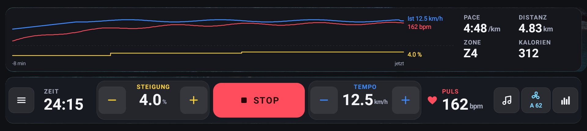
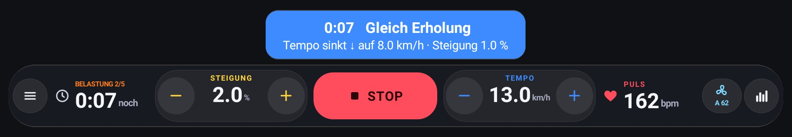

### Eigene Strecken

| **Import vom USB-Stick oder aus Downloads, prüfen und speichern** | **Streckenbibliothek: eigene Strecken und Beispiele** |
|---|---|
| 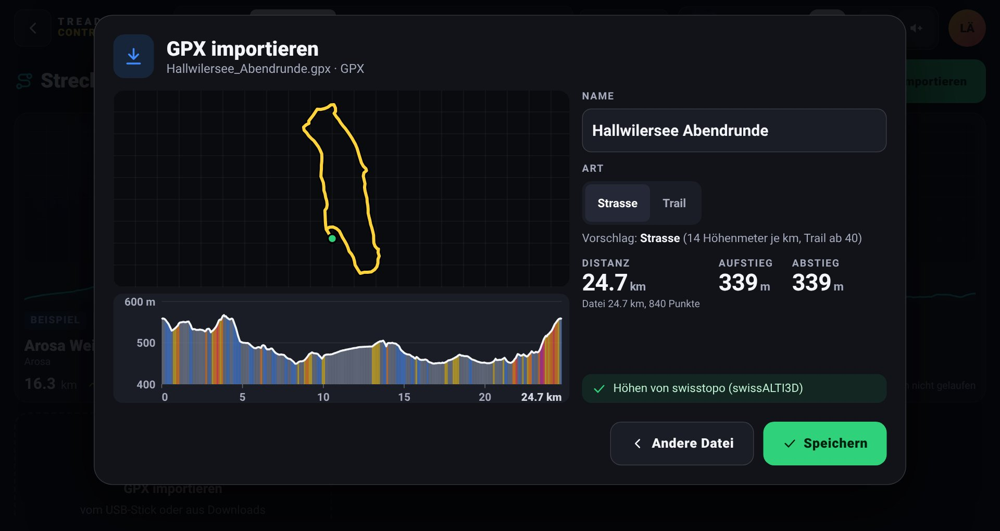 | 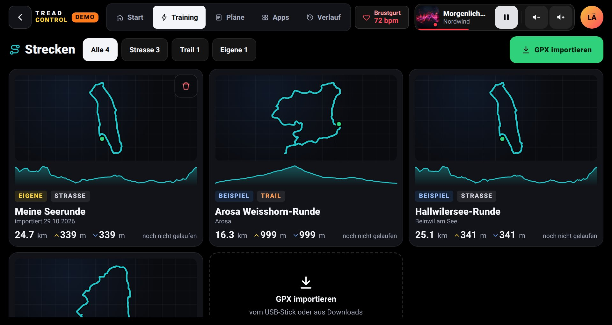 |
| **Planung: Luftbild, Höhenprofil, Pace je km** | **Im Lauf (simulierte Werte)** |
| 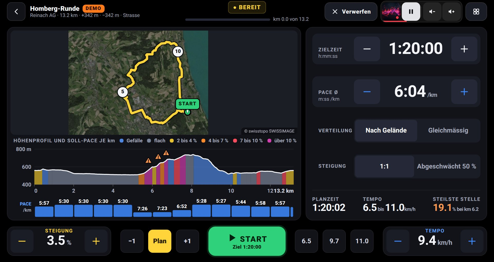 | 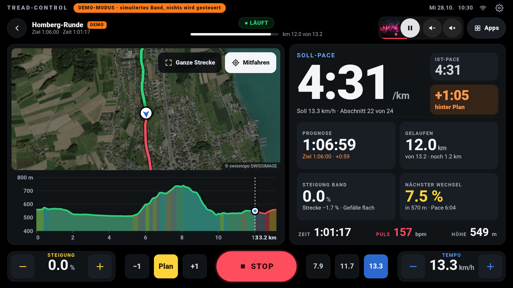 |
| **Trail-Planung** | **Trail im Lauf** |
| 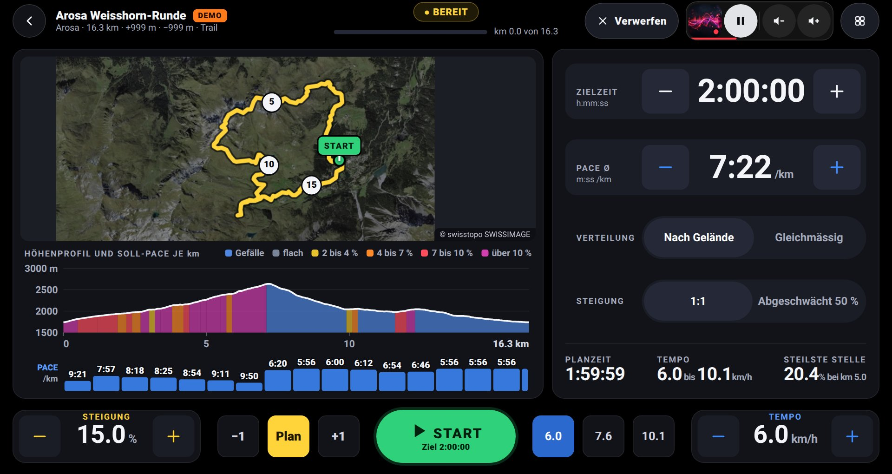 | 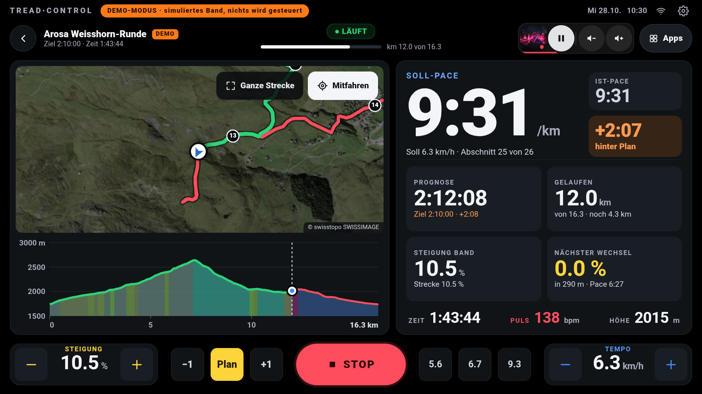 |

### Training

| **Intervalle** | **Pulszonen** |
|---|---|
| 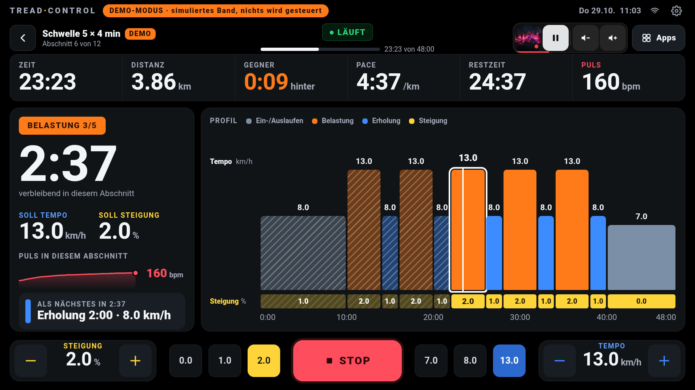 | 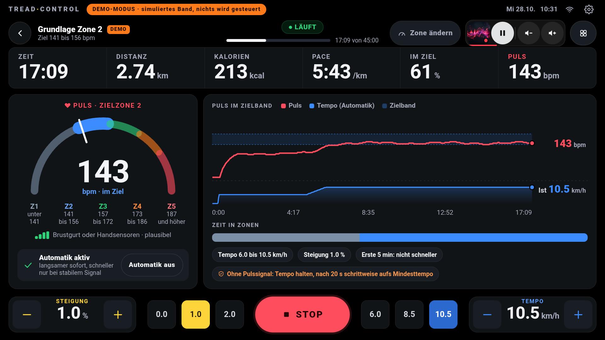 |
| **Trainingspläne** | **Stufentest für die maximale Herzfrequenz** |
| 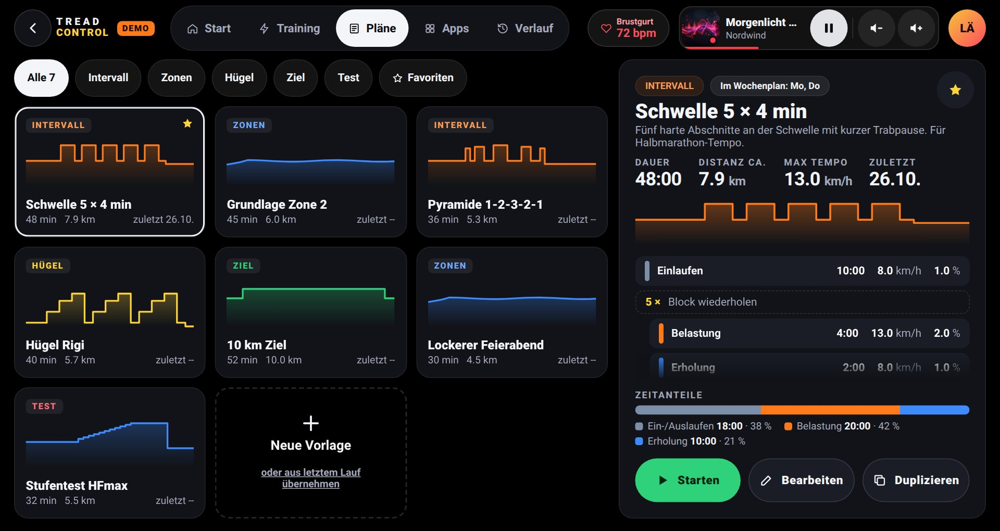 | 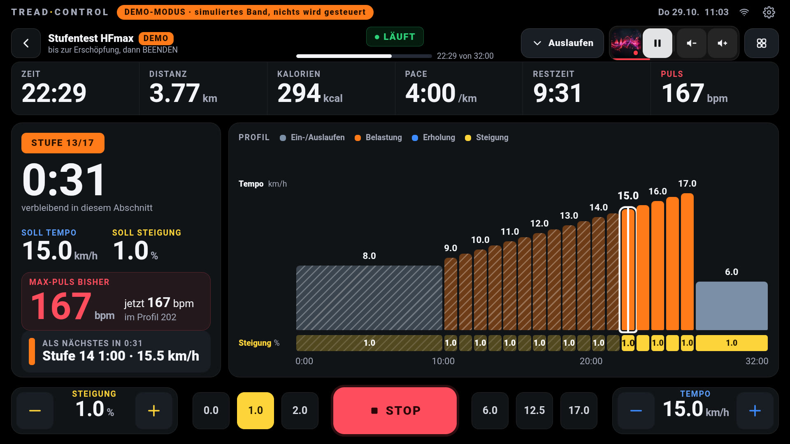 |

### Musik und Geräte

| **Mini-Player mit Quelle und Abspielgerät** | **Geräte: Puls, Ventilator, Lautsprecher** |
|---|---|
| 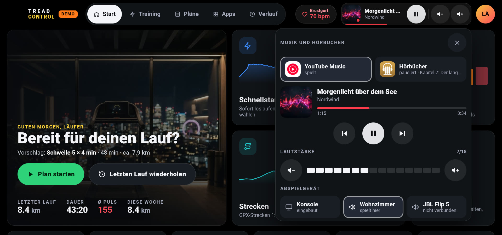 | 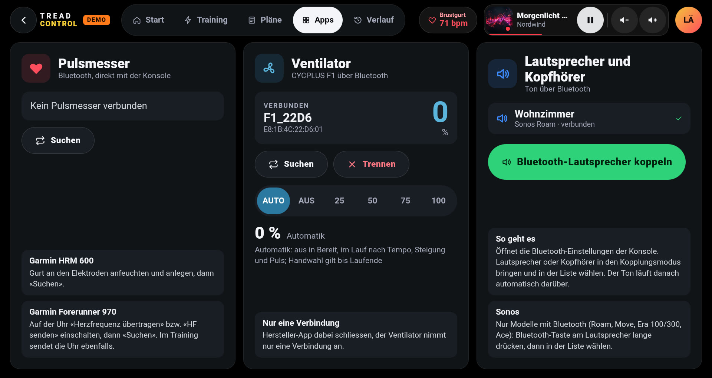 |

### Start und Zusammenfassung

| **Start** | **Zusammenfassung** |
|---|---|
| 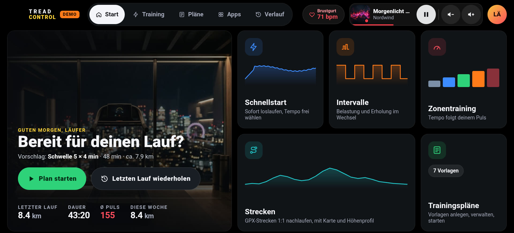 | 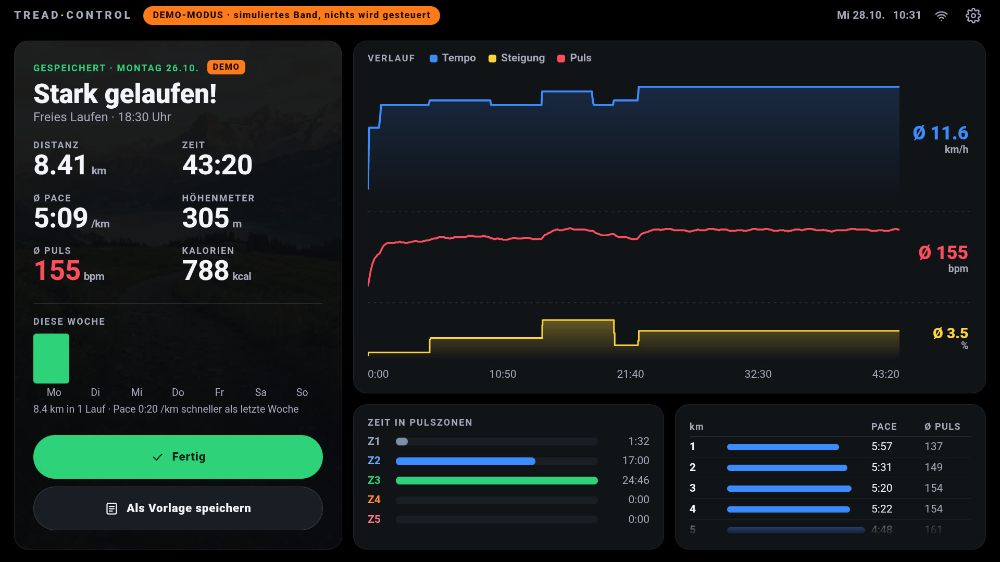 |

## Aufbau

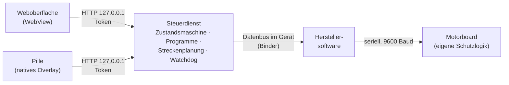

Die App läuft als System-App auf der Konsole und nutzt den geräteinternen Datenbus der
Herstellersoftware. Herstellersoftware, Firmware und Motorboard bleiben unverändert; die
Schutzlogik des Motorboards und der Sicherheitsschlüssel bleiben die letzte Sicherung.

## Wie es entstanden ist

Das Projekt ist auch ein Versuch mit **KI-gestützter Entwicklung**. Eine Person und ein
KI-Entwicklungsagent (Claude Code) haben es in wenigen Tagen gebaut, von der Analyse bis zum
geprüften Produkt:

1. **Analyse:** nur lesende Untersuchung von Konsole (Android, Rockchip), Hersteller-App und
   seriellem Protokoll, dokumentiert in [docs/de/serial-protocol.md](docs/de/serial-protocol.md).
2. **Zuerst Architektur und Sicherheitskonzept:** Zustandsmaschine, lokale API mit Token,
   Countdown-Regel, Watchdog, bevor sich ein Motor bewegt hat.
3. **Parallele Umsetzung:** spezialisierte Agenten für nativen Dienst, Weboberfläche und
   Prüfwerkzeuge, abgestimmt über einen gemeinsamen API-Vertrag ([docs/de/api.md](docs/de/api.md)).
4. **Unabhängige Review-Runden:** ein eigener Prüf-Agent hat jede Runde nach Sicherheit,
   Bedienbarkeit, Gestaltung, Robustheit und Codequalität benotet; jeder Befund wurde behoben und
   nachgeprüft. Die Noten sind ehrlich: Eine Runde fiel auf 6.5, weil sie einen kritischen Fehler bei
   Busausfällen fand. Dazu ein eigener Stabilitätsreview (Neustarts, Bluetooth, Uhrensprünge,
   hängende Oberfläche) und Leistungsmessungen am Gerät (Ruhelast der Oberfläche von 14 auf 3 %).
5. **Automatisierte Nachweise:** 103 Szenariotests der Steuerlogik gegen ein simuliertes Band
   (inklusive echter Hauptschleife bei Busausfall, Neustart und hängendem Bus), 119 Prüfpunkte für
   die Oberfläche (Darstellung, Barrierefreiheit, Lighthouse), 33 Sicherheitstests am Gerät, ein
   Zeitraffer-Simulator für Streckenpläne und Fehlertests am echten Band mit Person.

Menschen entscheiden, KI beschleunigt: Jeder Bandtest brauchte eine Person am Gerät, und jeder
Gestaltungsentscheid lief über den Besitzer.

## Ausblick

| Thema | Stand |
|---|---|
| **FTMS (Fitness Machine Service)** | Gebaut, im Test: FTMS und Laufsensor über das eigene Funkmodul der Konsole, DIRCON (FTMS über WLAN) für Apps auf der Konsole selbst, Steuerung durch Apps nur auf Wunsch und mit Grenzen (siehe [api.md](docs/de/api.md)). Der FTMS-Dienst des Herstellers wird angehalten, weil er an den Sicherheitsregeln vorbeigeht. Offen: Tests mit Garmin, Kinomap und Zwift am Band. |
| **ESP32-Lösung** | Schritt 1 gebaut, Test mit dem Board offen: ein ESP32-S3 (z. B. Olimex ESP32-S3-DevKit-Lipo) am USB der Konsole als eigenes Bluetooth-Funkmodul, Firmware in `esp32/`; nötig für Kinomap auf der Konsole, das kein DIRCON kann. Schritt 2 langfristig: direkte Steuerung über die serielle Leitung zum Motorboard (Weg 2 in [control-paths.md](docs/de/control-paths.md)), unabhängig von der Herstellersoftware. Die eigene Schutzlogik des Motorboards und der Sicherheitsschlüssel bleiben erhalten. |
| **Bandtests der neuesten Funktionen** | Gerätetasten nach der Umstellung auf alle Eingabegeräte, Tasten am Ventilator. |

## Voraussetzungen

- Horizon Tread-XP mit Konsole auf Android 10 (Build `userdebug`, `adb root` möglich). Andere
  Konsolen von Johnson Health Tech können ähnlich sein, sind aber nicht geprüft.
- Der **Plattformschlüssel des Geräts** (die App läuft als `android.uid.system`); nicht enthalten.
  Viele Rockchip-`userdebug`-Builds nutzen den öffentlichen AOSP-Testschlüssel.
- Android SDK (build-tools 34, platform 29), JDK 17, Node.js 20 (nur Tests), Python 3.

## Bauen und installieren

```bash
export TREADXP_ADB=192.168.1.50:5555          # Adresse der Konsole
# Schlüssel nach keys/platform.pk8 und keys/platform.x509.pem legen
python3 app/tools/kacheln-paket.py             # optional: Offline-Luftbild für die Beispielstrecken
bash app/build.sh
adb connect $TREADXP_ADB && adb -s $TREADXP_ADB root
adb -s $TREADXP_ADB install -r app/out/treadctl.apk
adb -s $TREADXP_ADB shell am start-foreground-service -n com.gapsch.treadctl/.TreadDaemon
```

## Prüfen

| Prüfung | Aufruf | Braucht Gerät |
|---|---|---|
| Szenariotests Steuerlogik (simuliertes Band) | `bash app/tools/coretest/test.sh` | nein |
| Oberflächen-Audit (Demo, Lighthouse, Barrierefreiheit; rund 3 min, 8 Browser-Tabs parallel, weniger mit `--par=4`) | `cd app/tools && npm ci && bash audit-waechter.sh` | nein |
| Zeitraffer Streckenplanung | `app/tools/sim/RouteSim.java` | nein |
| Zugriffsschutz | `bash app/tools/security-test.sh` | ja, Band steht |
| DIRCON (FTMS über WLAN, nur lesend) | `adb forward tcp:36866 tcp:36866 && python3 app/tools/dircon-test.py` | ja |
| Fehlerfälle am Band | `bash app/tools/fault-test.sh` | ja, **Person am Band** |
| Streckenmodus am Band | `bash app/tools/strecke-bandtest.sh` | ja, **Person am Band** |
| Leistung der Oberfläche am Gerät (Bilder, lange Aufgaben, CPU-Profil) | `node app/tools/perf-messung.mjs` (braucht `files/webdebug`, siehe [docs/de/api.md](docs/de/api.md)) | ja |

## Strecken

Die Beispielstrecken in `app/assets/www/strecken/` sind für dieses Projekt erstellt (Wege aus
OpenStreetMap, Höhen von swisstopo). Strecken von Laufveranstaltern sind bewusst **nicht**
enthalten; deren GPX-Dateien unterliegen den Bedingungen der Anbieter. Eigene Strecken werden auf der Konsole
importiert (GPX oder TCX vom USB-Stick oder aus «Downloads») und bleiben dort.

## Sprache

Oberfläche und Codekommentare sind deutsch (Schweizer Rechtschreibung). Die Dokumentation gibt es
auf Englisch ([docs/en](docs/en/)) und Deutsch ([docs/de](docs/de/)).

## Autor und Unterstützung

Mehr über den Autor und über IT für KMU: [kmu-cio.ch](https://kmu-cio.ch).
Wenn dir das Projekt hilft oder du etwas daraus gelernt hast: [Buy me a coffee auf Ko-fi](https://ko-fi.com/andreasgapsch).

## Lizenz

**GNU General Public License v3.0 oder später** ([LICENSE](LICENSE)). Veränderte Fassungen dürfen
weitergegeben werden, wenn ihr Quellcode unter derselben Lizenz offen bleibt. Drittkomponenten:
[NOTICE](NOTICE).

«Horizon», «Tread-XP» und «Johnson Health Tech» sind Marken ihrer Inhaber. Dies ist ein
unabhängiges Projekt, weder mit Johnson Health Tech noch mit anderen genannten Herstellern
verbunden.

---

Gebaut von [Andreas Gapsch](https://kmu-cio.ch) mit Claude Code als KI-Entwicklungspartner.
