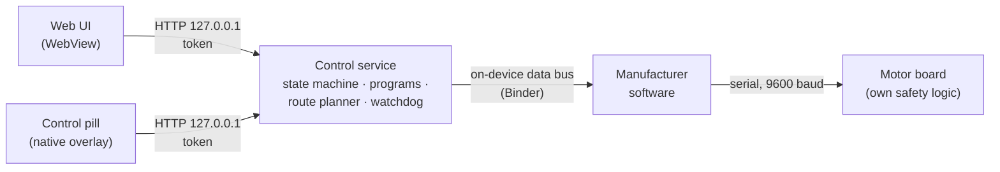

# Tread Control

**Turning a closed treadmill console into an open training platform, together with an AI coding agent.**

The Horizon Tread-XP has a large Android touch screen, but the manufacturer software decides what runs
on it. Tread Control replaces the training side with an own control service and touch UI and makes the
console an open platform: any Android app (YouTube, Jellyfin, YouTube Music, Audiobookshelf, Kinomap,
Zwift …) runs full screen, while a floating control pill keeps the belt, the training program, the music
and the fan under control. On top come interval and heart-rate training, training plans and your own running
routes from GPX or TCX files with an aerial map and live elevation profile.

It is also a **live experiment for learning**: how far can one person get with an AI coding agent
(Claude Code) when reverse engineering a real device, safely, from the first read-only look to a tested
product? The idea was inspired by two GitHub trends of autumn 2026: [REA (Reverse Engineer Anything)](https://github.com/morluto/rea),
where agents analyse software without source code, and [CleanYourTV](https://github.com/Gathin23/cleanyourtv),
where Claude Code takes back control of Android TVs. A treadmill is the same idea with higher stakes: it
can hurt you, so safety came first (see [How it was built](#how-it-was-built)).

**Version 1.0.0** (28 October 2026), first public release · [Releases](https://github.com/andreasgapsch/treadctl/releases)

[Deutsch](README.de.md) · [Safety](SAFETY.md) · [Legal notes](LEGAL.md) · [Docs](docs/en/) · [Author: kmu-cio.ch](https://kmu-cio.ch) · [Buy me a coffee](https://ko-fi.com/andreasgapsch)


> **Safety first.** This software drives a treadmill. A bug can cause falls and serious injury.
> Always wear the safety key and read [SAFETY.md](SAFETY.md) before use. Provided without any
> warranty.

## Features

| | |
|---|---|
| **Apps on the console** | App page with YouTube, YouTube Music, Jellyfin, Kinomap, Zwift and Audiobookshelf. Apps run full screen without the manufacturer bar; helper apps that are not needed are cleared from memory so that video apps start quickly. Only one training or video app runs at a time (Zwift, Kinomap, Jellyfin, YouTube); YouTube Music and audiobooks keep playing in the background. |
| **Floating control pill** | Native, opaque overlay at the bottom of every app (YouTube, Jellyfin, Audiobookshelf …): swipe up to show, swipe down to hide; incline, STOP, speed, live chart, change banners, own status line on top, screen saver. |
| **Own routes (GPX/TCX)** | Run your own tracks: import GPX or TCX files from a USB stick or Downloads (for example exported from Garmin Connect, Strava or Komoot), check name, type and key figures before saving, and find them under "Eigene" (own) in the route library. Elevation is corrected with the Swiss terrain model, the target time or pace is distributed by effort (ACSM running model), and the belt incline follows the course 1:1 or at 50 %. Live aerial map in Switzerland (green done, red to go), elevation profile, target pace, ahead/behind plan, finish forecast. Works fully offline once a route is imported. |
| **Intervals and plans** | Block-based plans with warm-up, repeats and cool-down; 10-second change announcements with tones. Step test to determine maximum heart rate, with a jump to the cool-down and take-over into the profile. |
| **Heart-rate zones** | Speed follows your pulse within a zone, with signal plausibility checks and safe fallbacks. |
| **Music and audiobooks** | Mini player in the header for YouTube Music and Audiobookshelf: play/pause, volume, source switch and choice of playback device (console or Bluetooth speaker). |
| **Devices** | Bluetooth heart-rate straps and watches (e.g. Garmin HRM 600, Forerunner broadcast), Bluetooth speakers, pairing from the heart-rate chip in the header. CYCPLUS F1 smart fan over Bluetooth LE: automatic level from speed, incline and heart rate, manual override from the pill. |
| **Safety core** | State machine, mandatory 3-second countdown before the belt moves, every start runs 15 s at 1 km/h before ramping up in steps of at most 3 km/h, STOP with priority over several independent paths, physical keys and rotary knobs of the console, safety key and bus monitoring, black box log. |
| **Fault tolerance** | If the control service fails, the pill restarts it and reads the STOP key itself; STOP goes straight to the manufacturer bus after 600 ms without an answer. Main-loop watchdog, run state survives a service restart, Bluetooth reconnects after outages, all deadlines on the monotonic clock. |
| **Local and private** | Control API on `127.0.0.1` only, token-protected, no cloud, no tracking. |

## App integrations

The main benefit: the console becomes a normal Android device for your apps, and the treadmill stays
under control on top of every app.

| What you do | How Tread Control helps |
|---|---|
| **Watch series or films** in Jellyfin, YouTube or SmartTube while running an interval plan | While running, a small translucent pill above the app shows pace, heart rate and incline; tap it for incline, STOP, speed, music player, fan and live chart. 10 s before every change a banner announces the new speed and incline, with tones at 3, 2, 1. When idle nothing covers the app: swipe up from the bottom edge for the pill with START. |
| **Run to music or an audiobook** (YouTube Music, Audiobookshelf) | The mini player in the header shows title and cover, controls play/pause and volume, switches between music and audiobook, and routes the sound to the console or a Bluetooth speaker. |
| **Follow video routes** in Kinomap or Zwift | The apps see the console as a smart treadmill (FTMS) and read speed, incline and distance over Bluetooth: on a tablet, phone or PC, and on the console itself through a small ESP32 board on its USB port ([esp32.md](docs/en/esp32.md)). If you allow it, apps may set speed and incline within your limits; a start from Kinomap or Zwift on the console runs the 3 s countdown of the START key, STOP always works. These apps show the run themselves, so Tread Control only offers menu and music from the bottom edge. |
| **Run with a Garmin watch** | The console also appears as a footpod: pace and distance on the watch come from the belt instead of the wrist estimate. |
| **Train by heart rate** with a chest strap or watch | Bluetooth heart-rate straps (e.g. Garmin HRM 600) and watches that broadcast heart rate feed the zone training, the step test and the fan. |
| **Keep cool automatically** | A CYCPLUS F1 smart fan follows speed, incline and heart rate; manual override from the pill. |
| **Build your own integration** | A local HTTP API on the console (token-protected) exposes the state and the commands, see the examples below and [docs/en/api.md](docs/en/api.md). |


### Examples: using the local API

Over `adb` from a computer in the same network (the API listens only on the console itself):

```bash
adb -s $TREADXP_ADB forward tcp:8765 tcp:8765
# read the state: status, speed, incline, heart rate, program
curl -s http://127.0.0.1:8765/api/state | jq '{st, speed, incline, hr, prog: .prog.name}'

# commands need the token (readable as root on the console)
TOKEN=$(adb -s $TREADXP_ADB shell cat /data/data/com.gapsch.treadctl/files/token)
curl -s -X POST -H "X-Token: $TOKEN" -d '{"c":"incline","v":2.0}' http://127.0.0.1:8765/api/cmd
curl -s -X POST -H "X-Token: $TOKEN" -d '{"c":"stop"}' http://127.0.0.1:8765/api/cmd

# load a 4 x 4 min interval plan (it does not start: the belt only starts after the countdown on the console)
curl -s -X POST -H "X-Token: $TOKEN" -d '{"c":"program","p":{"type":"interval","name":"4 x 4",
  "segs":[{"d":600,"s":8,"i":1,"k":"w"},{"d":240,"s":13,"i":1,"k":"h"},{"d":180,"s":8,"i":1,"k":"r"},
          {"d":240,"s":13,"i":1,"k":"h"},{"d":300,"s":7,"i":0,"k":"w"}]}}' http://127.0.0.1:8765/api/cmd

# music and fan
curl -s -X POST -H "X-Token: $TOKEN" -d '{"a":"toggle"}' http://127.0.0.1:8765/api/media/cmd
curl -s -X POST -H "X-Token: $TOKEN" -d '{"a":"level","v":60}' http://127.0.0.1:8765/api/fan
```

The API cannot start the belt on its own: every start needs the countdown on the console (screen or START
key) and runs 15 s at 1 km/h first.

## Screenshots

All images come from the demo mode (simulated belt, sample routes).

### Apps and the control pill

The app page is shown at the top. Inside every app the control pill floats at the bottom:


### Own routes

| **Import from USB stick or Downloads, check and save** | **Route library: own tracks and examples** |
|---|---|
|  |  |
| **Planning: aerial map, elevation profile, pace per km** | **On the run (simulated values)** |
|  |  |
| **Trail planning** | **Trail run** |
|  |  |

### Training

| **Intervals** | **Heart-rate zones** |
|---|---|
|  |  |
| **Training plans** | **Step test for maximum heart rate** |
|  |  |

### Music and devices

| **Mini player with source and playback device** | **Devices: heart rate, fan, speakers** |
|---|---|
|  |  |

### Home and summary

| **Home** | **Summary** |
|---|---|
|  |  |

## How it works



The app runs as a system app on the console and talks to the manufacturer's on-device data bus.
The manufacturer software, its firmware and the motor board stay untouched; the motor board's own
safety logic and the physical safety key remain the last line of defence.

## How it was built

This project is also an experiment in **AI-assisted engineering**. One person and an AI coding
agent (Claude Code) built it within a few days, from reverse engineering to a tested product:

1. **Analysis:** read-only investigation of the console (Android, Rockchip), the manufacturer
   app and the serial protocol, documented in [docs/en/serial-protocol.md](docs/en/serial-protocol.md).
2. **Architecture and safety concept first:** state machine, token-protected local API,
   countdown rule, watchdog, before any motor was moved.
3. **Parallel implementation:** specialised agents for the native service, the web UI and the
   test tooling, coordinated against one API contract ([docs/en/api.md](docs/en/api.md)).
4. **Independent review rounds:** a separate reviewer agent scored every iteration on safety,
   usability, design, robustness and code quality; every finding was fixed and re-checked. The
   scores are honest: one round dropped to 6.5 because it found a critical bus-failure bug. On top
   of that a dedicated stability review (restarts, Bluetooth, clock jumps, hanging UI) and
   performance measurements on the device (UI idle load down from 14 % to 3 %).
5. **Automated evidence:** 117 scenario tests of the control logic against a simulated treadmill
   (including the real main loop through bus failures, restarts and a hanging bus), 119 UI audit
   checks (rendering, accessibility, Lighthouse), 33 security tests on the device, a time-lapse
   simulator for route plans, and fault tests on the real belt with a person present.

Humans decide, AI accelerates: every belt test needed a person at the treadmill, and every design
decision went through the owner.

## Roadmap

| Topic | Status |
|---|---|
| **FTMS (Fitness Machine Service)** | Built and in use: FTMS and footpod from the console's own radio or the ESP32 board, DIRCON (FTMS over Wi-Fi) optional and off by default, app control opt-in with limits (see [api.md](docs/en/api.md)). The manufacturer's own FTMS server is stopped because it bypasses the safety rules. Kinomap and Zwift on the console work through the ESP32; open: Garmin footpod at the belt. |
| **ESP32 solution** | Step 1 done and in use: an ESP32-S3 (tested: Olimex ESP32-S3-DevKit-Lipo) on the console's USB as a separate Bluetooth radio for apps on the console and for watches, firmware 1.2.1 in `esp32/`, setup in [esp32.md](docs/en/esp32.md). Step 2 in the long run: direct control over the serial line to the motor board (path 2 in [control-paths.md](docs/en/control-paths.md)), independent of the manufacturer software. The motor board's own safety logic and the safety key stay in place. |
| **Belt tests of the newest features** | Hardware keys after the switch to reading all input devices, fan buttons. |

## Requirements

- Horizon Tread-XP console on Android 10 (`userdebug` build, `adb root` available). Other Johnson
  Health Tech consoles may be similar but are untested.
- The device's **platform signing key** (the app runs as `android.uid.system`); not included. Many
  Rockchip `userdebug` builds use the public AOSP test key.
- Android SDK (build-tools 34, platform 29), JDK 17, Node.js 20 (tests only), Python 3.

## Build and install

```bash
export TREADXP_ADB=192.168.1.50:5555          # console address
# put the key into keys/platform.pk8 and keys/platform.x509.pem
python3 app/tools/kacheln-paket.py             # optional: offline aerial tiles for the sample routes
bash app/build.sh
adb connect $TREADXP_ADB && adb -s $TREADXP_ADB root
adb -s $TREADXP_ADB install -r app/out/treadctl.apk
adb -s $TREADXP_ADB shell am start-foreground-service -n com.gapsch.treadctl/.TreadDaemon
```

## Tests

| Test | Command | Needs device |
|---|---|---|
| Control logic scenarios (simulated treadmill) | `bash app/tools/coretest/test.sh` | no |
| UI audit (demo mode, Lighthouse, accessibility; about 3 min, 8 browser tabs in parallel, fewer with `--par=4`) | `cd app/tools && npm ci && bash audit-waechter.sh` | no |
| Route planner time-lapse | `app/tools/sim/RouteSim.java` | no |
| Access protection | `bash app/tools/security-test.sh` | yes, belt stopped |
| DIRCON (FTMS over Wi-Fi, read-only) | `adb forward tcp:36866 tcp:36866 && python3 app/tools/dircon-test.py` | yes |
| Fault handling on the belt | `bash app/tools/fault-test.sh` | yes, **person at the treadmill** |
| Route mode on the belt | `bash app/tools/strecke-bandtest.sh` | yes, **person at the treadmill** |
| UI performance on the device (frames, long tasks, CPU profile) | `node app/tools/perf-messung.mjs` (needs `files/webdebug`, see [docs/en/api.md](docs/en/api.md)) | yes |

## Routes

The sample routes in `app/assets/www/strecken/` were created for this project (paths from
OpenStreetMap, elevation from swisstopo). Race organisers' routes are deliberately **not**
included; their GPX files are subject to the providers' terms. Your own tracks are imported on the console
(GPX or TCX from a USB stick or Downloads) and stay there.

## Language

The user interface and the code comments are in German (Swiss spelling). Documentation is
available in English ([docs/en](docs/en/)) and German ([docs/de](docs/de/)).

## Author and support

More about the author and about IT for small and medium-sized companies: [kmu-cio.ch](https://kmu-cio.ch).
If the project helps you or you learned something from it: [buy me a coffee on Ko-fi](https://ko-fi.com/andreasgapsch).

## License

**GNU General Public License v3.0 or later** ([LICENSE](LICENSE)). Modified versions may be
shared as long as their source stays open under the same license. Third-party components:
[NOTICE](NOTICE).

"Horizon", "Tread-XP" and "Johnson Health Tech" are trademarks of their respective owners. This is
an independent project, not affiliated with or endorsed by Johnson Health Tech or any other
manufacturer mentioned.

---

Built by [Andreas Gapsch](https://kmu-cio.ch) with Claude Code as AI pair engineer.
